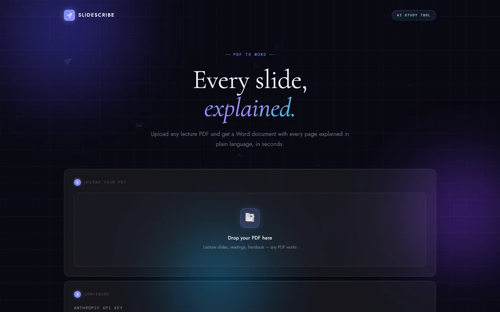

# SlideScribe

Upload a lecture PDF and get a document in which Claude explains every page in plain
language, ready to study from.

[Live app](https://danilomonge.github.io/Slidescribe/)

[](https://github.com/danilomonge/Slidescribe/actions/workflows/ci.yml)



## How it works

1. Upload a PDF: lecture slides, readings or handouts.
2. Each page is rendered in your browser and sent to Claude with your instructions.
3. Download a Word or PDF document with every page followed by its explanation.

## Usage

1. Open the [live app](https://danilomonge.github.io/Slidescribe/).
2. Create an API key at [console.anthropic.com](https://console.anthropic.com/settings/keys).
3. Drop your PDF and paste the key.
4. Choose the explanation language and the model, and adjust the instructions if you like.
   The estimated cost appears before you start.
5. Click Generate explanations, then download the `.docx` or `.pdf`.

## Features

| Feature | Description |
| --- | --- |
| Explanation language | The language of the slides, or one of eleven languages. |
| Your own instructions | Change tone, depth or focus. The instructions, language and model are remembered on your device. |
| Page selection | Leave pages out from the thumbnails or set a page range. Ctrl or Cmd + Z undoes. |
| Cost estimate | An estimate before you start and the real cost, from the API's token counts, while it runs. |
| Fast processing | Three pages are explained at the same time. |
| Automatic retries | Rate limits, overloads and network errors are retried with backoff. After six failed attempts the run pauses instead of skipping a page. |
| Nothing skipped silently | A page Claude declines, or an explanation cut short at the length limit, is marked in the document. |
| Pause, resume, cancel | Progress is saved in the browser after every page, survives a reload, and the pages done so far can be downloaded at any time. |
| Word export | Real headings (one per page, so the Word navigation pane lists every page), lists and tables. Page images keep their proportions. |
| PDF export | An embedded Unicode font, so Greek letters, arrows and math symbols print correctly. |
| Accessibility | Keyboard navigation, screen reader labels and a still background for reduced motion. |

## Models and cost

You pay Anthropic directly for the tokens you use. Approximate cost for 80 slides at high
image quality:

| Model | Best for | About |
| --- | --- | --- |
| Claude Haiku 5.5 | Fastest, lowest cost | $0.08 |
| Claude Sonnet 5.5 | Recommended balance of quality and cost | $1.55 |
| Claude Opus 5.5 | Highest quality | $3.10 |

Requests use API version `2026-10-21` with medium effort. For Sonnet and Opus, a request
declined by Anthropic's safety filters is retried on a fallback model automatically
(server-side fallback).

## Privacy and security

SlideScribe has no server. Your PDF is processed in your browser, and your API key and the
rendered pages are sent only to the Anthropic API.

- The API key is kept in session storage, so it is forgotten when the tab closes.
- Progress (the PDF and the finished pages) is stored in your browser's IndexedDB until you
  start over.
- A Content Security Policy only allows connections to `api.anthropic.com`, and every
  library loaded from a CDN is pinned with a Subresource Integrity hash.
- PDF.js runs with script evaluation disabled, which closes CVE-2024-4367 for untrusted PDFs.

See [SECURITY.md](SECURITY.md) to report a vulnerability.

## Development

The app is static and has no build step. Serve the folder with any static server:

```bash
python3 -m http.server 8000
# open http://localhost:8000
```

PDF export needs the page served over http, because browsers do not let a page opened from
`file://` load the bundled font.

### Tests

```bash
node --test 'tests/unit/*.test.mjs'   # parser, API client and cost
node tests/e2e/run.mjs                 # the whole app in headless Chrome
```

The end-to-end test runs the real page in headless Chrome with the Anthropic API replaced by
scripted responses, so it is free and needs no key. It covers retries, refusals, cut-short
answers, the exact request sent, both exports, reload persistence, cancelling and the phone
layout, and fails on any console error or CSP violation. It needs Node 22, Chrome, `unzip`
and `pdftotext`. Both suites run in CI on every push and pull request.

## Project structure

```text
.
├── index.html                  page structure, Content Security Policy
├── assets
│   ├── scripts
│   │   ├── config.js           models, prices, limits, default prompt
│   │   ├── anthropic.js        API request, error handling, cost
│   │   ├── markdown.js         parser shared by every output
│   │   ├── exporters.js        Word, PDF and on-screen preview
│   │   ├── core.js             loading, page selection, the run
│   │   ├── state.js            element references, state, IndexedDB
│   │   ├── helpers.js          DOM helpers, log, timing, settings
│   │   ├── icons.js            line icons
│   │   ├── undo.js             undo and redo for fields and pages
│   │   ├── paper-planes.js     background animation
│   │   ├── pdf-coverage.js     characters the PDF font can draw
│   │   └── bootstrap.js        start-up and event wiring
│   ├── styles/main.css
│   └── fonts                   DejaVu Serif for PDF export
├── tests
│   ├── unit                    node:test suites
│   ├── e2e/run.mjs             headless Chrome end-to-end test
│   └── fixtures                sample slides (HTML source and PDF)
└── docs                        README screenshot and social preview
```

## License

[MIT](LICENSE). The bundled DejaVu fonts are under their own free license, see
[assets/fonts/LICENSE-DejaVu.txt](assets/fonts/LICENSE-DejaVu.txt).
